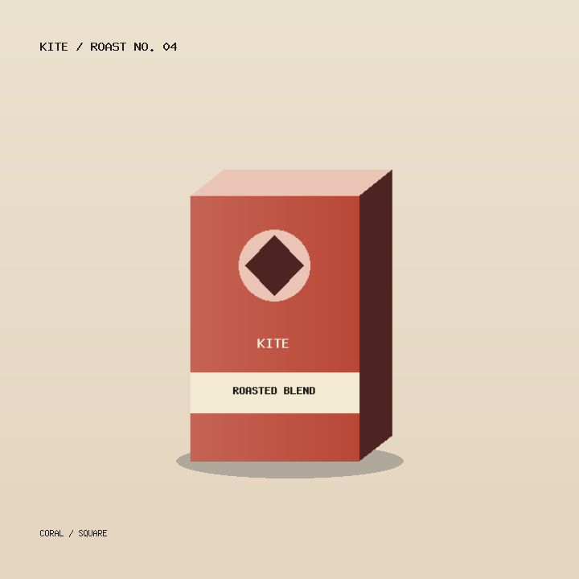

# Creative Batch

面向电商商品图的批量生产和审核工作台。运营冻结商品、渠道、素材授权与预算，工作进程生成候选。审核员比对包装和颜色，运营选定每个渠道的成稿，渠道人员下载带清单与校验摘要的交付包。



## 自托管

需要 PHP 8.2 以上、MySQL 8.4 及 PHP 的 `pdo_mysql`、`gd`、`zip`、`curl` 扩展。建一个专用数据库并将 `CREATIVE_MYSQL_DSN`、`CREATIVE_MYSQL_USER`、`CREATIVE_MYSQL_PASSWORD` 注入进程。

```shell
php bin/creative.php migrate
php bin/creative.php provision studio admin admin 2
php bin/creative.php provision studio producer operator 8
php bin/creative.php provision studio reviewer reviewer 8
php bin/creative.php provision studio channel channel 8
```

用管理员令牌设置 `CREATIVE_TOKEN`，执行 `php bin/creative.php seed` 初始化虚构品牌、两个色款和三个渠道。仅在新工作室执行一次。启动 Web 与后台 worker。

```shell
php -S 127.0.0.1:8104 -t public public/index.php
# 在单独进程注入运营身份的 CREATIVE_TOKEN
php bin/creative.php worker
```

浏览器打开 `http://127.0.0.1:8104/`。以运营身份选两个变体和三个模板，设置活动区间（最长覆盖到素材授权期内），生成、核对并提交。等待 12 项任务完成，以审核身份检查待审图，再由运营选图、核对并冻结交付包。用渠道身份下载 ZIP。

## 工作流

- 品牌、包装、模板与尺寸运用版本化目录。活动确认后冻结输入摘要和源图授权版本。
- 每个款式与渠道拥有独立的候选、重试预算和计费记录。断点回收原始回执，未知结果需人工对账。
- 渲染支持本地规则和 OpenAI 兼容的艺术指导接口。受约束的模型只选择布局和背景组合，PHP GD 以批准的透明商品图制作成图。
- 自动检查成图尺寸及商品主体采样像素。人工核对色彩、包装、外形、背景、标识，最终按款式与渠道各选一张。
- 清单记录源图和成图摘要、审核及选用版本、成本与有效授权。历史下载前重新核对授权和审批状态。

生产环境启用 TLS 和 PHP-FPM，安装与接口说明见 [维护说明](docs/operations.md)。集成记录见 [验收](docs/validation.md)，需求见 [产品文档](docs/requirements/01-产品总览-prd.md)。

Apache-2.0。
